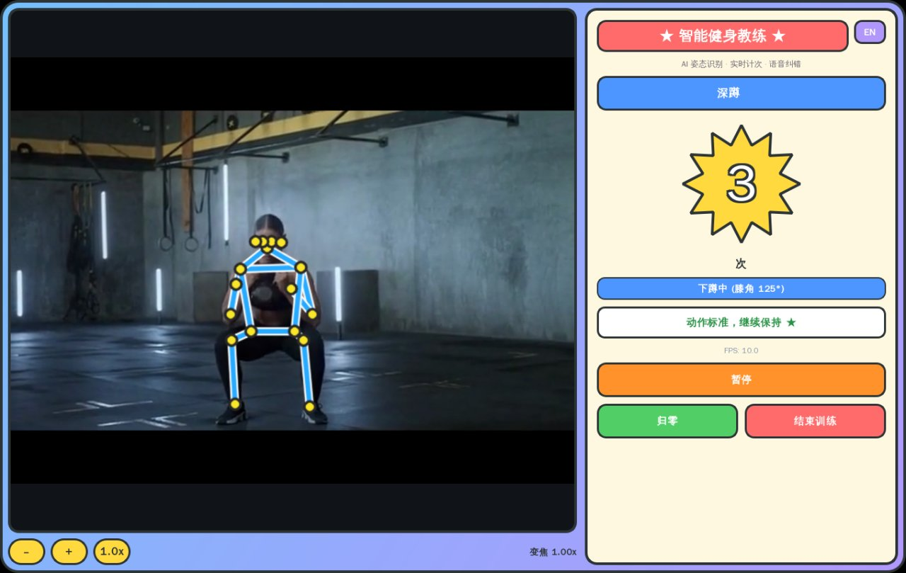

# AI Fitness Coach

[中文](README.zh-CN.md)

AI Fitness Coach (智能健身教练) is an edge-AI fitness application for Quectel Pi (RK3576). It captures video from a USB camera, runs YOLO11n-pose on the on-board NPU to track 17 body keypoints in real time, automatically counts six exercise types, and coaches you with bilingual voice feedback — completely offline.



## Features

- **Real-time pose recognition** — YOLO11n-pose (RKNN, fp16) on the RK3576 NPU, ~55 ms per inference
- **Six exercises** — squat / jumping jack / high knees / lunge / arm raise (rep counting) + horse stance (hold timing)
- **Smart counting gates** — multi-frame confirmation plus depth / torso-lean thresholds reject half reps and false counts
- **Form feedback** — when a rep is not counted, the reason stays on screen for 2 seconds (e.g. "上次蹲不够深(121°) 未计次")
- **Built-in demo videos** — every exercise ships with a standard-form demonstration video; the in-app player closes automatically when playback finishes
- **Digital zoom** — 0.5×–3× in 0.25× steps (on-screen buttons or `+` / `-` / `0` keys); recognition runs on the zoomed image
- **Bilingual UI & voice** — one-key switch between Chinese and English, offline voice packs included
- **Training control** — standby gate (no counting until you press Start), pause freezes the count, one-key reset

## Technology Stack

- Python 3 + PySide6 (Qt) GUI with QPainter skeleton overlay
- YOLO11n-pose converted to RKNN (fp16, no quantization), executed through librknnrt on the NPU
- OpenCV V4L2 camera capture with mirrored preview
- Offline voice packs generated with edge-tts, played via PipeWire with ALSA fallback
- Go static launcher + self-extracting `.run` installer

## Hardware Requirements

| Item | Requirement |
|---|---|
| Board | Quectel Pi (RK3576, 6 TOPS NPU) |
| Camera | USB UVC camera, 720p or higher recommended |
| Audio | Speaker or headset (follows system output route, Bluetooth works) |
| Storage | ~1 GB free for installation |

## Project Structure

```
├── code/                    # Application source
│   ├── main.py              # UI, camera loop, training control
│   ├── exercise_analyzer.py # Six exercise analyzers & counting rules
│   ├── pose_estimator.py    # Keypoint post-processing
│   ├── rknn_backend.py      # RKNN NPU inference wrapper
│   ├── audio_player.py      # Voice playback
│   ├── run.sh               # Launcher script (Wayland session discovery)
│   └── ai-fitness-coach     # Double-click launcher (static Go ELF)
├── models/                  # YOLO11n-pose ONNX + RKNN models
├── audio/                   # Offline voice packs (zh / en)
├── assets/refs/             # Exercise demonstration videos
└── tools/                   # Runtime build & packaging scripts
```

## Quick Start

### 1. Get the installer

Download `ai-fitness-coach-installer.run` (~220 MB, bundles the Python runtime, models, voice packs and demo videos) from the [Releases](https://github.com/MAODEHUANXIANG/demo-ai-fitness-coach/releases) page.

### 2. Push it to the board

```bash
adb push ai-fitness-coach-installer.run /home/q/
adb shell chown q:q /home/q/ai-fitness-coach-installer.run
```

### 3. Install

```bash
# Normal user q (recommended) → ~/ai-fitness-coach
adb shell su - q -c '/home/q/ai-fitness-coach-installer.run'

# or as root → /root/ai-fitness-coach
adb shell /home/q/ai-fitness-coach-installer.run
```

### 4. Launch

Double-click `code/ai-fitness-coach` in the file manager, or:

```bash
cd ~/ai-fitness-coach/code && ./run.sh
```

## Usage

1. Open the action list and select an exercise — tap **▶** next to any entry to preview its demonstration video
2. Press **开始训练** — counting opens immediately
3. Train in front of the camera; reps are counted and announced automatically, and uncounted reps show the reason on screen
4. Use the bottom bar at any time: pause / resume, reset, digital zoom, language switch
5. Press **结束训练** when done

### Counting rules

| Exercise | A rep is counted when |
|---|---|
| Squat | knees bend below ~115° then recover above ~145°, torso lean < 55° |
| Jumping jack | feet wider than 1.35× shoulder width and wrists above the head, then back together |
| High knees | either knee raised to hip height, then back down |
| Lunge | front knee bends below ~135°, torso kept upright |
| Arm raise | both wrists raised above the shoulder line, then lowered |
| Horse stance | feet beyond 1.1× shoulder width and knees below ~135° — hold time accumulates, resting does not reset it |

## FAQ

**Camera not detected?**

Check `ls /dev/video*` on the board and replug the USB camera; wait a few seconds after plugging in before launching.

**Reps not being counted?**

Only standard-form reps are counted. Read the on-screen reason (e.g. squat not deep enough), stand 2.5–3.5 m from the camera and keep the full body in frame.

**No voice output?**

The app follows the system audio route. Check the output device in system settings; a Bluetooth headset works as well.

## Technical Notes

For model conversion (ONNX → RKNN), runtime packaging and the full anti-miscount parameter set, see [TECH.md](TECH.md).
